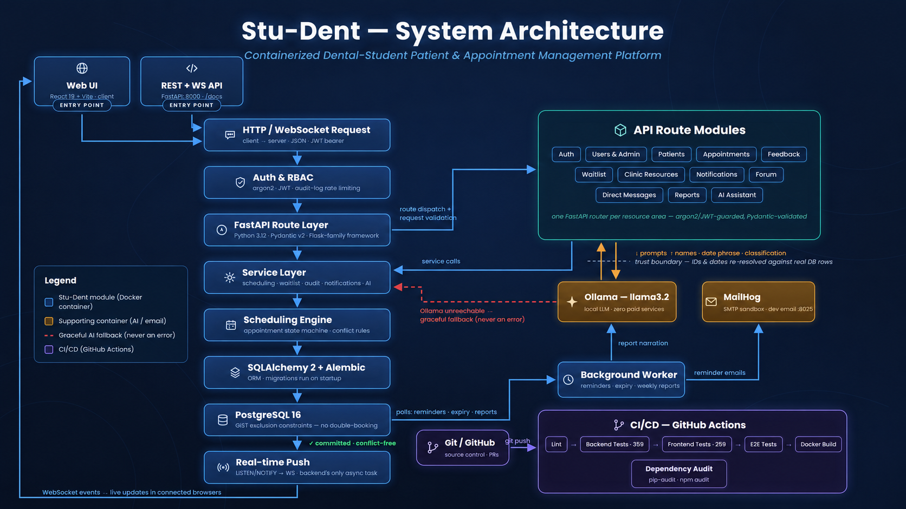

# Stu-Dent



Dental student appointment management system. Coordinates real patients, dental
students, attending (mentoring) dentists, rooms, and equipment — replacing the
WhatsApp/spreadsheet workflow currently used. See `docs/proposal.md` for the
full project proposal and `CLAUDE.md` for the phase roadmap and conventions.

Localhost-first, fully Dockerized, zero paid services.

## Contents

- [Getting started](#getting-started)
- [Features](#features)
- [Stack](#stack)
- [Everyday commands](#everyday-commands)
- [Demo data](#demo-data)
- [How key features work](#how-key-features-work)
- [Maintenance](#maintenance)
- [Known limitations](#known-limitations)

## Getting started

- Docker Desktop (with Docker Compose v2), running before any command below.
- No local Python/Node installation is required — everything runs in containers.

```powershell
docker compose up --build
```

(Git Bash/Mac/Linux: `./install.sh` does the same thing, plus waits for
everything to become healthy before printing the URLs below.)

That one command is genuinely everything — it builds and starts all 6 services
(`db`, `api`, `worker`, `frontend`, `mailhog`, `ollama`), runs database
migrations, pulls the local Ollama model, and seeds demo data, all
automatically. Nothing else needs to run separately for normal use (see
[Everyday commands](#everyday-commands) below if you want to re-run any one
of those by hand, and [How key features work](#how-key-features-work) for
how the Ollama and email pieces actually behave).

Then open:

- Frontend: http://localhost:5173
- API docs (Swagger): http://localhost:8000/docs
- MailHog web UI: http://localhost:8025

Stop the stack with `Ctrl+C`, then `docker compose down` (add `-v` to also drop
the Postgres volume and start from a clean database).

## Features

- **Auth & roles**: unified login/registration for student, attending, admin,
  and patient accounts, argon2 password hashing, JWT sessions, and
  login-rate-limiting backed by the audit log.
- **Appointments**: create, approve, edit, cancel, complete, or mark a
  no-show through a table view or a full day/week/month calendar, with
  database-enforced conflict prevention across student, patient, attending,
  room, and equipment at once.
- **Waitlist**: joining happens automatically when a booking attempt hits a
  real conflict — no manual "add me to a waitlist" form. Once whatever was
  blocking it frees up, the request is booked automatically, first-come-
  first-served.
- **Notifications & email**: in-app notifications with a live unread-count
  badge, mirrored to email via MailHog for local testing, for reminders,
  cancellations, expirations, and unresolved/pending-feedback nags.
  Forgot-password also sends its reset link by email — see
  [Password reset](#password-reset) below.
- **Forum**: a student community feed — posts, comments, and voting.
- **Messaging**: direct messages between a patient and their student,
  student/attending group chats, and a shared inbox for admin.
- **Admin management**: users, rooms, and equipment, including scheduled
  (date-limited) deactivation that auto-reactivates on its own.
- **Resources view**: an anonymized, clinic-wide room/equipment schedule so
  students and attendings can see what's free without seeing whose patient
  is using what.
- **Reports & local AI**: auto-generated weekly/monthly utilization reports,
  live ad-hoc natural-language Q&A, and a natural-language scheduling
  interpreter that pre-fills the appointment form for review — all backed by
  a local Ollama model, never trusted to make a booking decision itself.
- **Feedback**: after a completed appointment, the patient and attending (if
  one was assigned) can leave qualitative feedback for the treating student,
  with reminders until they do.

## Stack

- Backend: Python 3.12, FastAPI, SQLAlchemy 2, Pydantic v2, Alembic, pytest
- DB: PostgreSQL 16
- Frontend: React + Vite + TypeScript
- Infra: Docker Compose (`api`, `db`, `frontend`, `mailhog`, `worker`, `ollama`)

## Everyday commands

`./dev.sh` (Git Bash/Mac/Linux — no `make` dependency) wraps the full
`docker compose` commands below into short subcommands. On plain PowerShell,
use the Full command column directly.

| Task | `dev.sh` | Full command |
| --- | --- | --- |
| Start the stack | `./dev.sh up` | `docker compose up --build -d` |
| Stop the stack | `./dev.sh down` | `docker compose down` |
| Tail logs | `./dev.sh logs [service]` | `docker compose logs -f [service]` |
| Run backend tests | `./dev.sh test` | `docker compose exec api pytest -v` |
| Lint everything | `./dev.sh lint` | `docker compose exec api ruff check .` then `docker compose exec api black --check .`, then `docker compose exec frontend npm run lint` |
| Create + apply a migration | `./dev.sh migrate "<message>"` | `docker compose exec api alembic revision --autogenerate -m "<message>"` then `docker compose exec api alembic upgrade head` |
| Seed demo data | `./dev.sh seed` | `docker compose exec api python -m app.seed_demo` |

Migrations already run automatically on every `api` container start, and
demo data is already seeded automatically on first `up` (unless
`SEED_DEMO_ON_START=false` in `.env`) — this table is only for re-running
any of these by hand.

## Demo data

Already seeded automatically on first run (see [Getting
started](#getting-started)) unless you set `SEED_DEMO_ON_START=false` in
`.env`. Idempotent either way — re-running `./dev.sh seed` is always safe and
no-ops if already seeded. Populates realistic sample data (students,
attendings, patients across both onboarding paths, appointments in most
states, forum posts, direct messages, reports, etc.) and prints every seeded
account's login at the end. All accounts share one password: `DemoPass123!`.

| Role | Email(s) | Notes |
| --- | --- | --- |
| Admin | `admin@stu-dent.demo` | |
| Student | `student1@stu-dent.demo`, `student2@stu-dent.demo`, `student3@stu-dent.demo` | |
| Attending | `attending1@stu-dent.demo`, `attending2@stu-dent.demo` | |
| Patient | `patient1@stu-dent.demo` – `patient4@stu-dent.demo` | confirmed |
| Patient | `patient5@stu-dent.demo` | pending — not yet confirmed by their owning student, to demonstrate that flow |

## How key features work

### Local AI (Ollama)

The scheduling-interpretation and report/Q&A assistant features call a
local Ollama model, pulled automatically on first run (see [Getting
started](#getting-started)) — nothing to set up by hand. Both features
degrade gracefully (a plain warning / raw-data fallback, never an error) if
Ollama is unreachable or the model isn't pulled yet — if AI features seem to
always fall back, check `docker compose logs ollama-init` to confirm the
pull actually completed (it can still be in progress on a slow connection
the very first time). To re-pull or switch to a different model by hand:
`docker compose exec ollama ollama pull <model>`.

### Password reset

The login page's "Forgot password?" link sends a reset-link email through
MailHog, already running as one of the 6 services — open
http://localhost:8025 after requesting one to read it and follow the link
(no real email account or SMTP setup needed locally). The token expires
after 30 minutes and is single-use; requesting a reset for an email that
isn't registered still returns a generic success message (no
account-enumeration signal) and simply sends nothing.

### Google sign-in

The login and registration pages support server-side OAuth/OpenID Connect.
Existing accounts are linked when a provider returns the same verified email;
new users choose the same role (and, for patients, treating student) as the
email/password registration flow. Provider subjects are stored in
`oauth_identities`, so later sign-ins do not depend on an email remaining
unchanged.

Google OAuth credentials belong in the git-ignored `.env` file. Copy
`.env.example` to `.env`, then set `GOOGLE_OAUTH_CLIENT_ID` and
`GOOGLE_OAUTH_CLIENT_SECRET`; Compose loads that file after the committed
defaults, so Google sign-in works locally without publishing the secret.

Provider configuration:

- **Google:** create an OAuth 2.0 **Web application** client and register
  `http://localhost:8000/auth/oauth/google/callback` as an authorized redirect
  URI. Set `GOOGLE_OAUTH_CLIENT_ID` and `GOOGLE_OAUTH_CLIENT_SECRET` in `.env`.

Apple sign-in is shelved until the app has a permanent HTTPS deployment URL.
Its backend integration remains dormant so it can be enabled later without
redoing the OAuth implementation; no Apple option is shown in the current UI.

For production, also set `OAUTH_FRONTEND_URL` to the HTTPS frontend origin.
The callback URIs are exact-match values: a scheme, host, port, or path
difference causes the provider to reject the request. If credentials are
absent, the buttons return to the app with a clear configuration message.

## Maintenance

Both sections below exist for the same reason: reproducible, supply-chain-
safe builds, so the exact same bytes get built and run everywhere and any
upgrade is a deliberate, reviewable action rather than something that
happens silently underneath you. Low-frequency — most day-to-day work never
touches either.

### Updating backend dependencies

`backend/requirements.txt`/`requirements-dev.txt` are the source of truth for
version ranges; `requirements.lock.txt`/`requirements-dev.lock.txt` are
hash-locked (`pip-compile --generate-hashes`) and are what actually gets
installed (`Dockerfile`, CI). After changing a version range, regenerate both
lock files from a `python:3.12-slim` container so hashes match the image:

```powershell
./dev.sh update-deps
```

(Full form, for plain PowerShell. On Git Bash, use `./dev.sh update-deps`
above rather than copying this directly — it needs a `MSYS_NO_PATHCONV=1`
prefix there or MSYS mangles the container-side mount path.)
```powershell
docker run --rm -v "${PWD}/backend:/work" -w /work python:3.12-slim bash -c "
  pip install --no-cache-dir pip-tools &&
  pip-compile requirements.txt --generate-hashes --output-file=requirements.lock.txt &&
  pip-compile requirements-dev.txt --generate-hashes --output-file=requirements-dev.lock.txt
"
```

Commit all four files together.

### Base image digests

`backend/Dockerfile`, `frontend/Dockerfile`, `docker-compose.yml`, and
`.github/workflows/ci.yml` pin their base/service images
(`python:3.12-slim`, `node:22-alpine`, `postgres:16`, `ollama/ollama`,
`mailhog/mailhog`) by digest, not just tag, so a build a year from now uses
the exact same image bytes as today. To intentionally pick up new releases
and re-pin every one of them, everywhere each is referenced:

```powershell
./dev.sh update-digests
```

(Full form, per image: `docker pull <image>`, then
`docker inspect --format='{{index .RepoDigests 0}}' <image>` to get the new
digest, then update the `@sha256:...` suffix everywhere that image is
referenced.)

## Known limitations

- `POST /auth/register` accepts a `role` field with no admin gating — anyone
  can self-register as `student`, `attending`, or `admin`. This is an accepted
  simplification for a course project and is not production-safe. A real
  identity-verification + admin-approval gate for student/attending signups
  is planned but not yet designed — see `CLAUDE.md`'s Backlog section.
- Patients have two onboarding paths: a student can create one directly
  with credentials (`POST /patients`, auto-confirmed immediately), or a
  patient can self-register via `/auth/register` picking their student
  from the public `GET /students` directory — this leaves the connection
  pending until the chosen student calls `POST /patients/{id}/confirm`.
  An unconfirmed patient can log in and view their own profile but is
  blocked from booking appointments or messaging until confirmed.
- The top-level `ErrorBoundary` (`frontend/src/components/ErrorBoundary.tsx`)
  catches an otherwise-fatal render error and shows a "Something went
  wrong" screen instead of a permanent blank page, but only logs to the
  browser console (`console.error`) — there's no remote error-reporting
  service wired up, so a real user hitting an uncaught error in production
  is invisible to the team unless they report it themselves.
- The logo/wordmark is in Hebrew while the rest of the UI is English —
  a deliberate cosmetic choice, not the start of real internationalization.
  There's no i18n/RTL support anywhere else in the app, and none is
  planned.
- Postgres's port (`5432`) is published on all interfaces (`0.0.0.0`), not
  just `127.0.0.1` like Ollama's — a deliberate trade-off, not an oversight
  (see the comment on `db`'s `ports:` in `docker-compose.yml`): binding it
  to localhost-only broke outright on a real dev machine that already had
  a native Postgres service on port 5432. On a shared/lab network this
  means Postgres (default creds from `.env.example`) is LAN-reachable —
  fine for a localhost-first course project, worth knowing before running
  this on an untrusted network.
